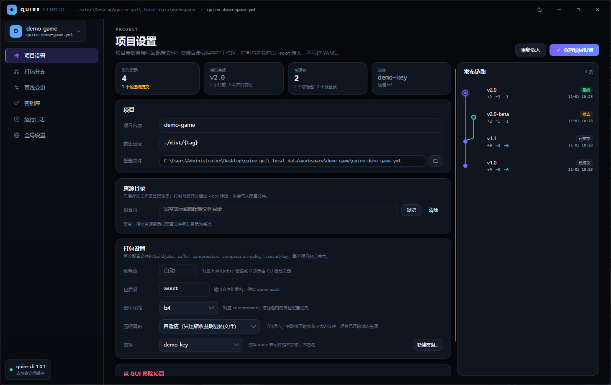
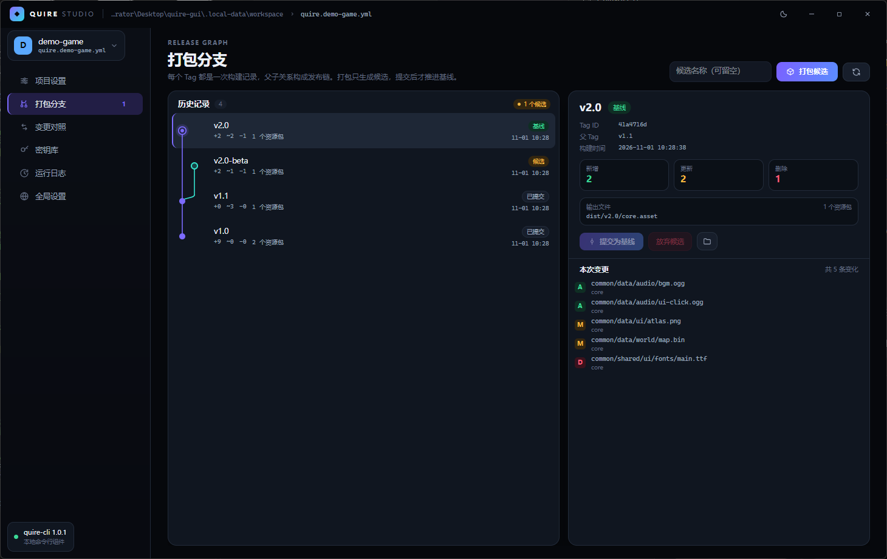
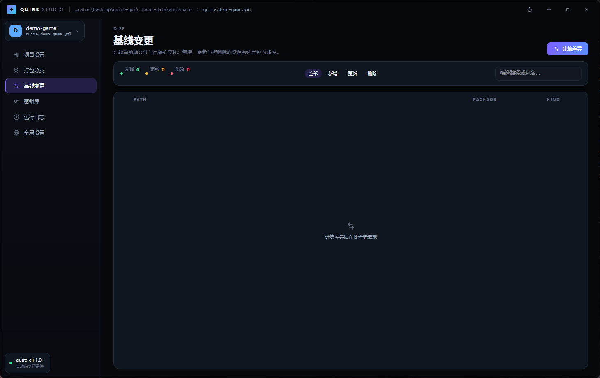
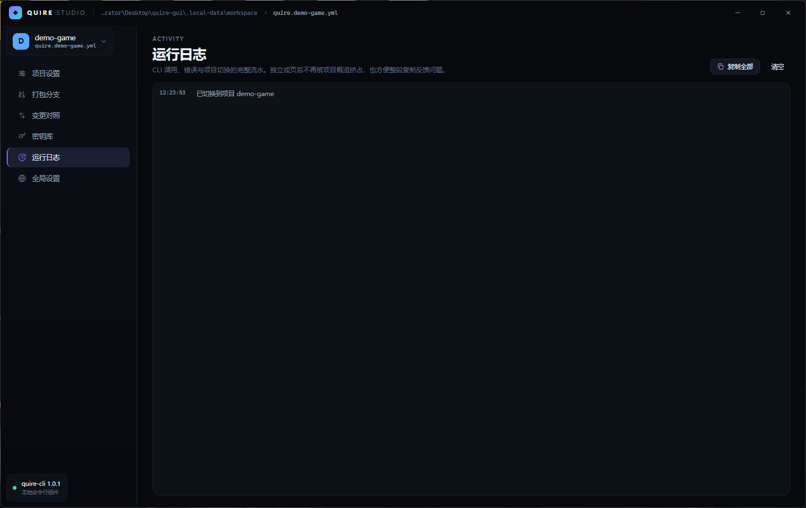
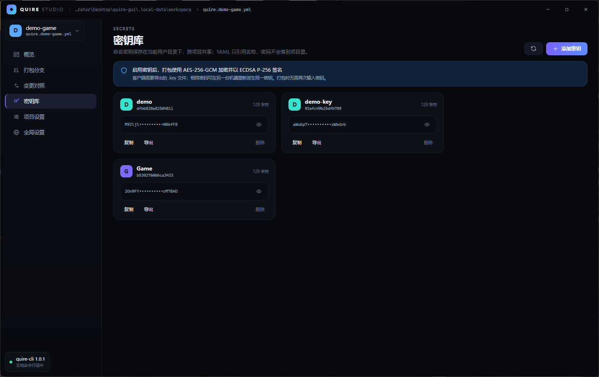
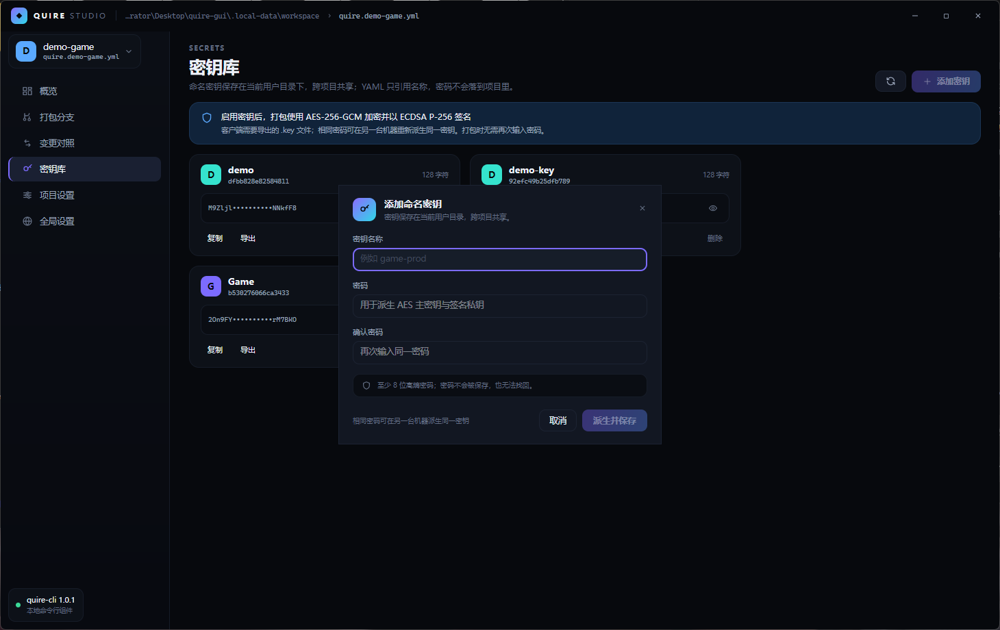
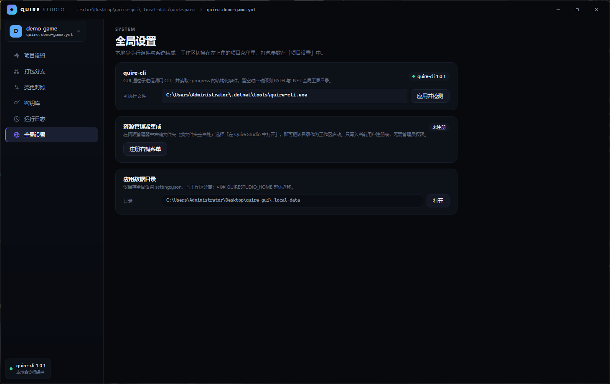

# Quire Studio

**面向 [quire-cli](https://github.com/l2060/Quire) 的跨平台图形管理器** — 用 .NET 10 + Avalonia 11 构建。

Quire 把资源目录打包成 `.asset` 文件，并用 Tag 维护一条可提交的发布链。命令行适合脚本与 CI，
但「现在哪个 Tag 是基线」「这次改了什么」「密钥在哪」在终端里并不直观。Quire Studio 把这些
能力做成桌面界面，同时保持与 CLI 完全一致的行为：**所有操作都通过真实的 `quire-cli` 子进程执行，
并读取 `-progress` 的结构化事件**，不存在第二套打包逻辑。



## 功能

| 界面 | 对应 CLI | 说明 |
| --- | --- | --- |
| 项目设置 | `tags` / `-f` / `-root` | 项目名称、输出目录、打包设置、密钥与资源目录；右侧是完整高度的发布链路 |
| 打包分支 | `package` / `commit` / `remove` / `tags` / `changes` | Git 分支样式的 Tag 历史图；打包候选、提交基线、放弃候选、查看构建变更 |
| 基线变更 | `diff` | 当前源文件相对基线的 A/M/D 列表，支持类型筛选与路径搜索 |
| 密钥库 | `keys add/list/show/remove/export` | 全局命名密钥；对话框录入、明文遮蔽、复制、导出、二次确认删除 |
| 运行日志 | — | CLI 调用、错误与项目切换的完整流水，可整段复制 |
| 全局设置 | — | quire-cli 位置、资源管理器集成、应用数据目录 |

此外：

- **工作区统一管理项目**：工作区保存自己的 `projects.json` 与项目目录；切换工作区即切换整套项目。
  工作区与最近历史都在**左上角的项目菜单**里，和项目切换放在一起。
- **首次启动先选工作区**：程序不会擅自使用默认目录；选定后记住，下次直接启动沿用它。
- **最近工作区历史**：最多保留 10 条，随时切回。
- **资源管理器集成**：右键文件夹（或文件夹空白处）→「在 Quire Studio 中打开」，以该目录为工作区启动。
- **配置就地编辑**：项目名称、输出目录、`suffix`、`build.jobs` 与 `secret-key` 会按行写回 YAML，
  注释、字段顺序与 GUI 不认识的字段都原样保留；`-root` 只存在工作区登记表里，不写进 YAML。
- **实时进度**：`package` 期间展示阶段、文件数、字节数和取消按钮，进度来自 `-progress` 事件。
- **可复制的错误**：页面底部的错误条支持一键复制到剪贴板，便于反馈。
- **输出驱动的看门狗**：只有连续一段时间**没有任何输出**才判定 CLI 挂起（轻量命令 60 秒、重查询 5 分钟、打包/差异 3 分钟）；打包再久，只要还在输出进度就不会被打断。
- **三档主题**：亮色 / 暗色 / 跟随系统，入口在标题栏右上角，选择写入设置并在下次启动沿用。
- **大列表分页**：单次构建可能有十几万条文件变更，列表按 300 条一页生成并虚拟化，不会卡死。

## 界面

| 打包分支 | 基线变更 |
| --- | --- |
|  |  |

| 项目设置 | 运行日志 |
| --- | --- |
|  |  |

| 密钥库 | 添加密钥对话框 |
| --- | --- |
|  |  |

| 全局设置 |
| --- |
|  |

### 分支图

`打包分支` 把 Tag 的父子关系渲染成与 Git 一致的图形：顶部是最新的 Tag，连线由子指向父，
同一父 Tag 下的多个候选会占用并列泳道并在父行弯折汇合。节点样式区分三种状态：

- **基线**：带光晕的环形节点（当前 `commit` 的最新记录）
- **已提交**：实心圆点
- **候选**：浅色描边的空心节点，可直接提交基线或放弃

## 工作区

工作区是 GUI 管理项目的根目录，也是 `projects.json` 的所在地：

```text
<工作区>\
├── projects.json              项目登记表（本次工作区的全部项目）
├── demo-game\                 项目目录（新建项目默认创建在这里）
│   ├── quire.demo-game.yml
│   ├── assets\
│   ├── dist\
│   └── .quire\demo-game\      构建状态（由 CLI 维护）
└── another-project\
```

工作区来源只有两种，**没有内置默认目录**：

1. 启动参数 `--workspace <目录>`（资源管理器右键菜单传的就是它）
2. 上次关闭时使用的工作区

第一次启动（或两者都没有时）会停在「选择工作区」界面，必须先选定目录才能创建项目。
打开一个尚无 `projects.json` 的目录时，会自动把该目录及其一级子目录中的
`quire*.yml` / `quire*.yaml` 识别为项目，所以右键打开一个已有工程目录即可直接使用。

## 资源管理器右键菜单

在「全局设置 → 资源管理器集成」中点击「注册右键菜单」，即可在 Windows 资源管理器中获得：

```text
右键文件夹            → 在 Quire Studio 中打开
右键文件夹空白处      → 在 Quire Studio 中打开
右键驱动器            → 在 Quire Studio 中打开
```

实现只写入 `HKCU\Software\Classes\{Directory,Directory\Background,Drive}\shell\QuireStudio`，
当前用户生效、无需管理员权限，可随时在同一处移除。等价的命令行操作：

```powershell
QuireStudio.exe --register-shell
QuireStudio.exe --unregister-shell
```

> 若当前会话令牌受限（无法写注册表），程序会自动把同样的菜单项导出成
> `%LOCALAPPDATA%\QuireStudio\quire-studio-shell.reg`，双击导入即可生效；错误条会给出该路径。

## 环境要求

- **.NET 10 SDK**
- **quire-cli 1.0.1 或更高版本**（`dotnet tool install --global quire-cli`）

CLI 不需要出现在 `PATH`：启动时会依次尝试全局设置中指定的路径、`PATH`、`%USERPROFILE%\.dotnet\tools`。

## 构建与运行

```powershell
dotnet build QuireStudio.slnx -c Release
dotnet run --project src/QuireStudio -c Release
```

### 消除 Windows 的安全提示

程序内嵌的清单声明了 `asInvoker` 权限（`app.manifest` 的 `trustInfo`），并可用开发证书签名，
以避免「打开文件 - 安全警告」与 SmartScreen「Windows 已保护你的电脑」。

```powershell
pwsh -File tools/sign-dev.ps1          # 生成/复用本机开发证书并签名 Release 输出
pwsh -File tools/sign-dev.ps1 -Remove  # 撤销证书
```

该脚本只在当前用户范围安装自签名证书（根 + 受信任的发布者），不需要管理员权限。
如果仍被 SmartScreen 拦截，可在「Windows 安全中心 → 应用和浏览器控制」中允许该应用。

发布单文件版本：

```powershell
dotnet publish src/QuireStudio -c Release -r win-x64 --self-contained false -o artifacts/win
dotnet publish src/QuireStudio -c Release -r linux-x64 --self-contained false -o artifacts/linux
dotnet publish src/QuireStudio -c Release -r osx-arm64 --self-contained false -o artifacts/macos
```

支持 Windows、Linux 与 macOS（Avalonia 的原生后端）。

## 数据与启动参数

应用数据目录只保存全局设置，项目与登记表都在工作区里：

```text
%LOCALAPPDATA%\QuireStudio\
└── settings.json              上次工作区、最近工作区历史、CLI 路径
```

**不需要管理员权限**：程序只写自己的用户目录与所选工作区。如果数据目录因策略或受限
令牌而不可写，启动时会依次回退到 `%TEMP%\QuireStudio`、程序目录下的 `.quirestudio`，
并在顶部提示实际使用的位置——功能照常，只是提示你把它挪到长期可写的地方。
设置 `QUIRESTUDIO_HOME` 可整体迁移应用数据目录（便携模式或隔离测试）。

```powershell
QuireStudio.exe --page tags                     # 直接打开指定页面
QuireStudio.exe --workspace "D:\game-assets"    # 指定本次工作区
QuireStudio.exe --home "D:\QuireHome"           # 指定应用数据目录（等价 QUIRESTUDIO_HOME）
QuireStudio.exe --register-shell                # 注册资源管理器右键菜单
```

可用页面标识：`overview`、`tags`、`changes`、`keys`、`settings`、`global`。

## 架构

按职责分三层，依赖方向单向向下：

```text
src/QuireStudio
├── Domain/            纯领域模型，不引用 Avalonia
│   ├── QuireTag.cs / QuireChange.cs / QuireKey.cs
│   ├── ProjectConfiguration.cs      YAML 的只读投影
│   ├── ProjectRecord.cs             登记项（含逐项目的 -root 与 -jobs）
│   └── History/TagGraph.cs          Tag 分支图布局算法
├── Infrastructure/    进程、存储与平台集成
│   ├── AppPaths.cs                  应用数据目录与路径规范化
│   ├── Cli/                         CliProcessRunner（NDJSON + 看门狗）、QuireCliClient
│   ├── Configuration/               ProjectConfigurationReader（YamlDotNet）
│   ├── Platform/                    ExplorerIntegration（HKCU 右键菜单）
│   ├── Storage/                     ProjectRegistry、AppSettings、原子化 JSON 读写
│   └── WorkspaceProjectImporter.cs  打开目录时自动识别已有的 quire 配置
└── Presentation/       Avalonia
    ├── ViewModels/     主窗口 + 6 个页面 + 对话框
    ├── Views/          XAML（自绘标题栏、页面、模态对话框）
    ├── Controls/       TagGraphGutter（分支图绘制）、IconPresenter、ErrorBanner
    └── Themes/         设计令牌与控件样式
```

关键取舍：

- **CLI 是唯一事实来源**。GUI 不解析 `.quire/` 状态、不自己算增量；所有结果来自 CLI 的
  `item` / `completed` 事件，因此与命令行行为严格一致。
- **全局与项目分离**。工作区、CLI、系统集成属于全局；配置文件、`-root`、`-jobs` 属于项目。
- **失败不吞掉**。CLI 的失败会带上 `error.code` 与 `stderr` 显示在页面上；写登记表失败只记日志而不崩溃。
- **不留僵死状态**。所有子进程都有超时或取消路径，界面不会因为 CLI 挂起而永久等待。

### 分支图算法

`TagGraphBuilder` 按构建时间倒序遍历 Tag：

1. 若当前 Tag 已被其子 Tag 预留泳道，则占用该泳道；否则分配最小空闲泳道。
2. 把泳道预留给它的父 Tag（同一父 Tag 的第二个子 Tag 会另开泳道，形成分支）。
3. 为每条「子 → 父」边计算跨越的行，生成贯通连线；跨泳道时在父行内用三次贝塞尔弯折。

每行只绘制属于自己的线段与节点，因此可以直接放进 `ItemsControl`，不需要维护整图坐标或同步滚动。

## 与 CLI 的对应关系

```text
新建项目          quire-cli init <name> <dir> -progress
打包候选          quire-cli package -f <yml> -tag <name> -root <dir> -jobs <n> -progress
提交基线          quire-cli commit <tag> -f <yml> -progress
放弃候选          quire-cli remove <tag> -f <yml> -progress
历史与状态        quire-cli tags -f <yml> -progress
构建变更          quire-cli changes <tag> -f <yml> -progress
工作区差异        quire-cli diff -f <yml> -root <dir> -progress
新增密钥          quire-cli keys add <name> <password> -progress
列出密钥          quire-cli keys list -progress
导出客户端密钥    quire-cli keys export <name> <file> -progress
删除密钥          quire-cli keys remove <name> -progress
```

密码只在 `keys add` 的参数中出现一次，命令行展示与日志都会把它替换为 `••••••••`。

## 已知边界

- 界面聚焦发布链与密钥管理；`inspect` / `verify` / `unpackage` 尚未纳入（可继续沿用 CLI）。
- 删除密钥只影响本机条目，已导出的客户端密钥文件不受影响。
- 配置文件中未被 GUI 使用的字段会被原样保留：GUI 只读取，不重写 YAML。
- 资源管理器集成仅 Windows 可用；其他平台通过 `--workspace` 或历史列表切换工作区。

## 许可

示例数据与截图仅用于演示。上游 Quire 项目的许可证见其仓库。
